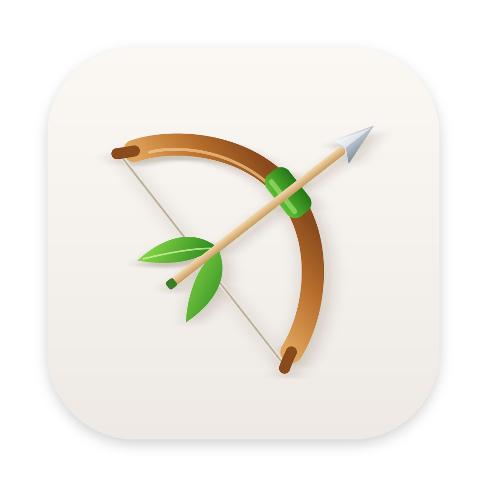

<p align="center"></p>

# Bowshot

Turn your own copy of **Zelda: Ocarina of Time (Switch 2)** into a native Mac app, with sharper graphics and a smooth frame rate.

Bowshot is a small Mac app that builds the game **on your Mac, from your own game file**. It is based on [nxnative](https://github.com/seedds/nxnative) and the Ocarina of Time work from [kid-with-sword-remake](https://github.com/cheemu21/kid-with-sword-remake). **No game files are included**, and you can only play the copy you build yourself.

> **Experimental preview, version 0.1.2.** Tested only with Ocarina of Time **update v131072** on Apple silicon Macs.

**[Download Bowshot 0.1.2](https://github.com/xBritik/Bowshot/releases/tag/v0.1.2)**

## What's new in 0.1.2

- **Newer engine:** nxnative main of 23 November 2026 (225 commits after 0.1.1). The first build compiles every shader again, so it takes **1.5 hours or more**.
- **40 fps option** for Ocarina of Time on a 120 Hz screen (a steadier middle between 30 and 60), the dynamic resolution's threshold following the frame rate target, and fixes to the Vert+ screen shape.
- **Memory and stutters:** graphics memory given back under pressure, idle textures evicted, pipelines adopted before the first frame, archive writes kept out of play, and a lighter replay of each frame.
- **Sound** comes back after the output device changes, and the **microphone gain** starts at 1x instead of 4x.
- **Render scale** now follows nxnative's: 100 % is the game's own 3D size (1440x810 handheld), so **Native (1920x1080) is gone**. Potato (the default) keeps its size, and the slider is marked Potato and Game's own: there is no Normal any more.

Everything from [0.1.1](CHANGELOG.md#011-20-nov-2026) (the performance record, the builder that shows it is alive) and [0.1.0](CHANGELOG.md#010-21-nov-2026) (MetalFX upscaling, the Performance HUD, the friendlier builder) is still there.

**[Read the full changelog →](CHANGELOG.md)**

## Contents

- [What's new in 0.1.2](#whats-new-in-012)
- [What you need](#what-you-need)
- [Install, step by step](#install-step-by-step)
  1. [Download Bowshot](#1-download-bowshot)
  2. [Set up your Mac (once)](#2-set-up-your-mac-once)
  3. [Prepare your game folder](#3-prepare-your-game-folder)
  4. [Build the game](#4-build-the-game)
  5. [Play](#5-play)
- [If something goes wrong](#if-something-goes-wrong)
- [Keep it private](#keep-it-private)
- [For developers](#for-developers)
- [Credits](#credits)
- [Licence and project identity](#licence-and-project-identity)

## What you need

- A Mac with an **Apple chip** (M1 or newer) and **16 GB of memory or more**.
- **macOS 26.6 or later.**
- **About 100 GB of free disk space.**
- **Your own copy of Ocarina of Time (Switch 2) with update v131072**: either one `.nup` file, or the `.nsp` files (the game plus the update). Bowshot does not provide this file and does not say where to find it.
- An internet connection, and your Mac **plugged in**. Allow **half a day**: the downloads are large and the first build takes **1.5 hours or more**.

Not sure about your Mac? Click the Apple menu → **About This Mac**. The chip must say "Apple M…", and you can read the memory and the macOS version there. To update macOS: Apple menu → **System Settings** → **General** → **Software Update**.

## Install, step by step

Follow the steps in order. When you see a grey box of text, it is a command: **copy it, paste it into the Terminal app (⌘ V), and press Return.**

### 1. Download Bowshot

1. Go to the [Bowshot 0.1.2 release page](https://github.com/xBritik/Bowshot/releases/tag/v0.1.2), scroll to **Assets**, and click **`Bowshot-0.1.2-macOS-arm64.zip`**. Do **not** download the files named **Source code** or **`Bowshot-0.1.2-source.zip`**: they hold the project's code, not the app.
2. Open your **Downloads** folder and double-click that zip file. An app called **Bowshot** (with a bow-and-arrow icon) appears next to it.
3. Drag **Bowshot** into your **Applications** folder. Don't open it yet.

### 2. Set up your Mac (once)

Open **Bowshot**. It walks you through four screens: **Your Mac**, **Game**, **Build** and **Done**. If your Mac is missing something, the first one lists what to do, with a button for each step; when every line has a green check, **Continue** opens the next screen (and if nothing is missing, Bowshot skips it). No Terminal and no Homebrew are needed.

1. **Xcode** (version 27.2 or later). Xcode is a very large download that Bowshot cannot install for you: click **Open App Store**, install it, then open Xcode once, accept the licence and let it finish its setup. If Xcode is installed but not selected, click **Select Xcode…** (your Mac asks for its password).
2. **Metal Toolchain.** Click **Install**: Bowshot downloads Apple's graphics compiler (a few GB).
3. **Build tools.** Click **Install**: Bowshot downloads `uv`, `glslang` and `zstd` into its own folder (`~/Library/Application Support/Bowshot/tools`). Each download is checked against a fixed SHA-256 before it is used.

When you come back to Bowshot after the App Store or Xcode, it checks again by itself; **Check Again** does it on demand. Already have these tools from Homebrew? Bowshot uses them and shows a green check.

### 3. Prepare your game folder

1. In the **Finder**, open the **Go** menu → **Home**.
2. Create a new folder there (⇧ ⌘ N) and call it **`Ocarina`**.
3. Copy **your game file** (the `.nup`, or the `.nsp` files) into it.

Don't put it on the Desktop, in Documents or in iCloud Drive: those can sync with iCloud, and the build writes tens of gigabytes. Don't put it inside a Git project either.

### 4. Build the game

1. Open **Bowshot** from Applications. **The first time, right-click it → Open, then close the pop-up** (click **Done**; do **not** choose *Move to Trash*). The app is not signed by Apple, so your Mac blocks it once. Then open **System Settings → Privacy & Security**, scroll down, click **Open Anyway** next to Bowshot, confirm, and open the app again.
2. Click **Choose Game Folder…** and pick the **Ocarina** folder (the folder, not the file inside).
3. The **Build My Local Game** button turns **blue**. Click it. If it stays grey, the line under it says why (missing game file, wrong folder…).
4. **Wait.** A progress bar shows the current step and the time left. Keep the Mac **plugged in and awake** (don't close the lid) and don't do anything heavy meanwhile.
5. You are done when the status says **Local build ready**.

Building again later is much faster: it reuses what is still valid.

### 5. Play

1. In Bowshot, click **Open game folder**. A folder called **Bowshot-local** opens.
2. Open **Ocarina of Time** inside it. **The first time, do the same: right-click → Open, close the pop-up, then Privacy & Security → Open Anyway.** If your Mac asks whether the app may access a folder, click **Allow**: it needs that for your saves.
3. A settings window appears. You can leave it as it is and start the game.
4. Play with the **keyboard or a controller** (Xbox, PlayStation and most Bluetooth pads work).
5. To quit, press **⌘ Q**. **Save in the game first**, or your progress is lost.

**While you play:**

| Keys | What it does |
|---|---|
| **⌘ =** | Sharper picture (heavier) |
| **⌘ −** | Lighter picture (smoother) |
| **⌥ ⌘ P** | Show or hide the Performance HUD |

**Tips for smooth play:** play **in a window** and keep it **visible** (don't cover it or drag it between screens); short stutters the first time you see a new area are normal; close other apps and stay plugged in; if it stutters, lower the **Render scale** (⌘ −).

## If something goes wrong

| Problem | What to do |
|---|---|
| "The app cannot be opened" | Right-click it → **Open**, close the pop-up (don't move it to the Trash), then **System Settings → Privacy & Security → Open Anyway**. |
| **Build My Local Game** stays grey | Read the line under it: wrong folder, game file missing, or the folder is in iCloud or a Git project. Redo step 3. |
| A red line with `Missing prerequisite` or `uv is missing` | Redo step 2, then the check at the end of it. |
| A red line about **Xcode 27.2** or the **Metal Toolchain** | You need exactly that version of Xcode. Open it once, then run `xcodebuild -downloadComponent MetalToolchain` again. |
| `The supported Ocarina of Time v131072 RomFS image was not found` | Your folder doesn't have **update v131072**. This version works only with that update. |
| The build stops | The red line in the log says why. The full log is `Ocarina/Bowshot-local/build.log` (and under **Show build log** in the window). Click **Build My Local Game** again: it picks up where it stopped. |
| Black game window | Keep the window visible and in front, and don't use full screen. If it stays black, quit (⌘ Q) and reopen. |

Still stuck? [Open an issue](https://github.com/xBritik/Bowshot/issues) with your Mac model, macOS version, and the error message. **Never attach game files, saves or keys.**

## Keep it private

**Never share, upload or publish** `Ocarina of Time.app`, the `Bowshot-local` folder, your game file or your saves. They contain game material and must stay on your Mac. Bowshot itself contains no game files.

---

# For developers

Everything below is for people who want to understand, build or contribute to Bowshot.

### Where things are

| What | Where |
|---|---|
| Your game app (private) | `<game folder>/Bowshot-local/Ocarina of Time.app` |
| Build log | `<game folder>/Bowshot-local/build.log` |
| Settings chosen for your build | `<game folder>/Bowshot-local/runtime.env` |
| Game settings file (overrides) | `~/Library/Application Support/nxnative/0400486024DEC000/env.txt` |
| Game log (attach to bug reports; its `perf:` lines give the frame rate every 10 seconds) | `~/Library/Logs/nxnative/0400486024DEC000.log` |
| Builder's engine copy and Python | `~/Library/Application Support/Bowshot/` |

### Building Bowshot from source

This makes the **game-free builder**, not a game. The Python tools need Python 3.12 or newer, which `uv` provides (macOS's own `python3` may be older). Install the tools of step 2 first, then:

```sh
git clone https://github.com/xBritik/Bowshot.git
cd Bowshot
uv run --no-project --python 3.14 tools/check_content.py
uv run --no-project --python 3.14 -m unittest discover -s tests -v
uv run --no-project --python 3.14 tools/package_builder.py
```

`dist/` then holds `Bowshot.app`, the builder ZIP, a source ZIP, `SHA256SUMS.txt` and `CONTENT-CHECK.json`; `dist/` is ignored by Git. Publish the checked ZIPs as release assets, not the app bundle. To make it again, delete `dist/` first.

To see the game's settings window without a game or a build (about a minute):

```sh
uv run --no-project --python 3.14 scripts/preview_launcher.py
```

For a local game build without the builder window:

```sh
bash scripts/bowshot_build.sh --doctor
bash scripts/bowshot_build.sh --build /path/to/your/game-folder
```

### What belongs on GitHub

| Shareable project material | Keep private and outside the repository |
|---|---|
| This source snapshot and its original licence notices | NUP, NSP, NSZ, XCI, XCZ and extracted game modules |
| Bowshot's game-free builder ZIP | Any locally generated game app (`Ocarina of Time.app`) or game IPA |
| Source ZIP, content-check report and SHA-256 checksums | RomFS images, game models, textures, audio and overlays |
| Build instructions and upstream acknowledgements | Translated game shader libraries, pipeline caches, saves and console keys |

Run `python3 tools/check_content.py --staged` before staging changes. Ignore rules do not remove files already committed. This snapshot starts without upstream Git history; its origin and revision are in `UPSTREAM-REVISION`, [CREDITS.md](CREDITS.md) and [AUTHORS.md](AUTHORS.md).

### Known limitations

- This is a builder, not a prebuilt copy of Zelda. Each player builds from their own files.
- Performance and visual issues can come from the underlying engine. There is no guarantee of 60 FPS or glitch-free lighting.
- A fresh machine needs the development tools of step 2; the .NET SDK is not needed.
- The first local build is lengthy. Don't run a compiler-heavy build while judging gameplay performance.
- The game's memory limit is set from your Mac's memory (2 GB less, between 8 and 48 GB). The game itself needs 13 to 16 GB while it runs, with short peaks when an area loads, so on a 16 GB Mac it can still close itself. Bowshot refuses to build on a Mac with less than 16 GB.
- Upstream gameplay screenshots are omitted from this snapshot; some historical documentation still refers to that gallery.
- Apple silicon only. The underlying project's iPhone and other workflows are not Bowshot release claims.

## Credits

The original developers deserve the credit for the runtime, graphics and game support:

| People / project | Contribution |
|---|---|
| [seedds / nxnative](https://github.com/seedds/nxnative) | Base project, host/runtime, Metal integration, rewriter and continuing fixes. Original MIT copyright retained. |
| [Motion_Viz / GreenKid-MV](https://github.com/adi0900/GreenKid-MV) | The project Bowshot is forked from: the local-builder launcher, content checks and packaging, the Normal / Potato resolution presets and game-file overlays, the GPU-hang watchdog and the dispatch and texel-fetch clamps. |
| [cheemu21 / kid-with-sword-remake](https://github.com/cheemu21/kid-with-sword-remake) | The fork GreenKid-MV 0.1.0 was built on: Ocarina-specific integration, presets, upscaling work and documented Mac/iPhone experiments. |
| Xipzer | Performance work credited in the imported history and fork documentation. |
| Pedro Nascimento | Imported graphics-scale work and other contributions, as recorded in the upstream history. |
| [All recorded upstream contributors](AUTHORS.md) | The complete author list from the pinned source snapshot, with example commit links. |
| [jhaizhou-ops / d2r-mobile](https://github.com/jhaizhou-ops/d2r-mobile) | The native-execution foundation acknowledged by nxnative. |
| Ryujinx, LibHac, SPIRV-Cross, Atmosphère, MacNativeGames and the other dependency authors | Translation, extraction, system references and supporting libraries. See [THIRD_PARTY_NOTICES.md](THIRD_PARTY_NOTICES.md). |

Bowshot, like GreenKid-MV before it, adds the distribution boundary, local-builder launcher and packaging checks. It does not claim authorship of the imported engine fixes. The straightforward README organization was inspired by [NX2navi](https://github.com/tangerineturtle1/NX2navi); none of that project's code, artwork or restricted additions were imported.

## Licence and project identity

The imported engine retains its [MIT licence](LICENSE). Third-party components retain their own terms and notices. The original upstream overview is retained in [UPSTREAM_README.md](UPSTREAM_README.md).

No software licence grants rights to Nintendo's game content. Removing game data from a release is a technical distribution boundary, not legal clearance. Bowshot is an independent project and is not affiliated with or endorsed by Nintendo. Game and platform names belong to their respective owners.
